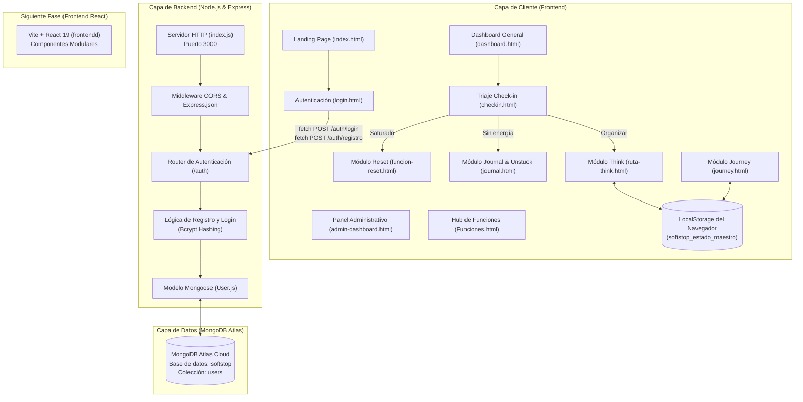

# Arquitectura Técnica y Conceptual de SoftStop

> **"El mundo afuera va demasiado rápido. Aquí no. Desacelera."**  
> **SoftStop: Tu espacio de bienestar y solución integral para la procrastinación.**

---

## 1. ¿De qué trata el proyecto?

### 1.1. Resumen Ejecutivo
**SoftStop** es una plataforma web de bienestar y productividad compasiva diseñada principalmente para estudiantes y profesionales que enfrentan **sobrecarga cognitiva, parálisis por análisis, agotamiento mental (burnout) y procrastinación**.

A diferencia de las aplicaciones tradicionales de productividad que imponen presión, listas infinitas de tareas y métricas de rendimiento estresantes, SoftStop propone un enfoque inverso: **frenar primero para poder avanzar con claridad**. Su lema y filosofía de diseño buscan brindar un "refugio digital" con estética serena (*glassmorphism*, tonos pastel suaves, animaciones fluidas y paisajes relajantes) donde el usuario puede regular su sistema nervioso, reordenar sus ideas y dar pasos accionables sin fricción ni culpa.

---

### 1.2. Fundamentos Psicológicos y Metodológicos
El diseño y los flujos de SoftStop están respaldados por corrientes psicoterapéuticas y neurocientíficas contemporáneas:

1. **Terapia de Aceptación y Compromiso (ACT - Acceptance and Commitment Therapy):**
   - **Matriz ACT (4 Cuadrantes):** Conexión con los valores fundamentales, identificación de miedos y barreras internas, reconocimiento de conductas de evasión o procrastinación, y planteamiento de soluciones comprometidas.
   - **Técnica del "Pasajero en el Autobús":** Externalización y desidentificación de pensamientos negativos intrusivos ("No voy a poder", "Esto es demasiado difícil") tratándolos como pasajeros que acompañan el viaje, sin permitir que tomen el volante.
2. **Regulación del Sistema Nervioso Autónomo:**
   - **Técnicas de respiración guiada:**
     - *Método 4-7-8:* Inducción de calma profunda y reducción del cortisol.
     - *Respiración en Caja (Box Breathing):* Foco cognitivo y estabilización del ritmo cardíaco.
3. **Técnica de Grounding Sensorial 5-4-3-2-1:**
   - Enraizamiento en el momento presente a través de los cinco sentidos para interrumpir rumiaciones y episodios de ansiedad aguda.
4. **Escritura Expresiva Efímera (Journaling Catártico):**
   - Descarga mental rápida bajo el principio de **privacidad absoluta**: el texto escrito se libera y se destruye voluntariamente sin almacenarse en ninguna base de datos, eliminando la auto-censura.
5. **Micro-activación Somática y Conductual (Unstuck):**
   - Estimulación física de baja resistencia para romper la inercia del cuerpo cuando el usuario está paralizado o sin energía.

---

## 2. Mapa Arquitectónico General del Sistema

SoftStop opera bajo una arquitectura desacoplada **Cliente-Servidor (Client-Server)** con persistencia híbrida (Base de datos relacional/documental en nube + Almacenamiento local en navegador):



---

## 3. Arquitectura del Backend

El backend está desarrollado sobre **Node.js** utilizando el framework minimalista **Express.js**, conectado a **MongoDB Atlas** mediante el ODM **Mongoose**.

### 3.1. Estructura de Directorios del Backend
```
Backend/
├── .env                  # Variables de entorno confidenciales (PORT, MONGODB_URI)
├── .gitignore            # Exclusiones de Git (node_modules, .env)
├── index.js              # Punto de entrada principal y configuración del servidor
├── package.json          # Metadatos del proyecto y dependencias
├── package-lock.json     # Árbol de dependencias bloqueado
├── pruebas.rest          # Archivo de pruebas de endpoints HTTP (REST Client)
└── src/
    ├── config/
    │   └── db.js         # Módulo de conexión a la base de datos MongoDB
    ├── models/
    │   └── User.js       # Esquema y modelo de Usuario
    └── routes/
        └── auth.routes.js# Definición de rutas y controladores de autenticación
```

### 3.2. Tecnologías y Librerías del Backend
| Paquete | Versión | Propósito Arquitectónico |
| :--- | :--- | :--- |
| **express** | `^5.3.0` | Enrutamiento HTTP, middlewares y gestión de ciclo de petición/respuesta. |
| **mongoose** | `^9.11.3` | Modelado de datos orientados a documentos, validación de esquemas y conexión a MongoDB. |
| **bcryptjs** | `^3.0.3` | Hashing unidireccional y comparación segura de contraseñas mediante salazón (salt rounds: 10). |
| **cors** | `^2.8.6` | Habilitación de Cross-Origin Resource Sharing para peticiones originadas desde el frontend. |
| **dotenv** | `^18.0.8` | Inyección de variables de entorno desde el archivo `.env` al objeto global `process.env`. |

### 3.3. Configuración y Conexión de Red
En `index.js`, se incluye la resolución explícita de servidores DNS:
```javascript
require('node:dns').setServers(['8.8.8.8', '1.1.1.1']);
```
Esta directiva previene fallos de resolución de nombres al conectar con clústeres DNS SRV de MongoDB Atlas en redes locales restringidas o proveedores de internet específicos.

### 3.4. Endpoints y Lógica de Negocio (`/auth`)

#### A. Registro de Usuario (`POST /auth/registro`)
- **Entrada requerida (`req.body`):** `{ nombre, email, password }`
- **Validaciones:**
  - Presencia de campos obligatorios (retorna código `400` si faltan).
  - Verificación de duplicados en la base de datos por campo `email` (retorna código `409 Conflict`).
- **Seguridad:** Encripta la contraseña usando `bcrypt.hash(password, 10)`.
- **Salida (`201 Created`):** `{ id, nombre, email }` (omitiendo deliberadamente el `passwordHash`).

#### B. Inicio de Sesión (`POST /auth/login`)
- **Entrada requerida (`req.body`):** `{ email, password }`
- **Validaciones:**
  - Presencia de credenciales (código `400`).
  - Búsqueda del usuario por correo electrónico en MongoDB.
  - Validación de contraseña mediante `bcrypt.compare(password, usuario.passwordHash)` (código `401 Unauthorized` si no coincide).
- **Salida (`200 OK`):** `{ id, nombre, email }`.

---

## 4. Arquitectura del Frontend Principal (MPA)

El frontend principal está estructurado como una **Multi-Page Application (MPA)** basada en estándares web nativos (HTML5 semántico, CSS3 moderno y JavaScript Vanilla modular), garantizando alta velocidad de renderizado, accesibilidad y máxima compatibilidad sin sobrecarga de frameworks.

### 4.1. Estructura de Directorios del Frontend
```
Frontend/
├── index.html            # Landing page interactiva principal
├── login.html            # Portal unificado de inicio de sesión y registro
├── dashboard.html        # Panel general de usuario autenticado
├── admin-dashboard.html  # Panel de administración interna y métricas
├── Funciones.html        # Vista radial de selección de herramientas
├── checkin.html          # Diagnóstico y triaje de estado emocional
├── funcion-reset.html    # Espacio de respiración consciente y grounding
├── journal.html          # Espacio de descarga mental efímera y Unstuck
├── ruta-think.html       # Sistema integral de claridad mental y Matriz ACT
├── journey.html          # Registro visual de progreso y momentos
├── contacto.html         # Página de contacto, soporte e información institucional
├── Fondo.py              # Script utilitario en Python para generación de LQIP (Low-Quality Image Placeholder)
├── css/                  # Hojas de estilo modulares
│   ├── fondo-animado.css # Efectos de gradientes y animaciones SVG
│   ├── footer.css        # Estilos de pie de página
│   ├── funciones-stack.css # Efectos de apilamiento en 3D
│   ├── Funciones.css     # Estilos radiales del menú de funciones
│   ├── global.css        # Reglas base, variables y tipografías
│   ├── header.css        # Encabezado unificado
│   ├── hero.css          # Animaciones del Hero principal
│   ├── login.css         # Formularios y estados de validación
│   ├── mensajes.css      # Sistema de textos rotativos
│   ├── reset.css         # Normalización de estilos CSS
│   ├── responsive.css    # Media queries y adaptabilidad móvil
│   ├── ruta-think.css    # Interfaz SPA del módulo cognitivo Think
│   ├── scroll-reveal.css # Animaciones disparadas por desplazamiento
│   ├── styles.css        # Archivo maestro de estilos
│   └── variables.css     # Paleta de color, tipografía y sombras
├── js/                   # Controladores y motores interactivos en JavaScript
│   ├── animaciones-hero.js # Control de elementos dinámicos en el Hero
│   ├── checkin.js        # Lógica de triaje y enrutamiento emocional
│   ├── funcion-reset.js  # Motor de temporizadores, respiración y grounding
│   ├── funciones-stack.js# Manipulación de tarjetas apiladas en el landing
│   ├── Funciones.js      # Navegación del panel de funciones
│   ├── journal.js        # Vaciado de texto no persistente y paso a Unstuck
│   ├── login.js          # Consumo de API `/auth`, validaciones y redirecciones de rol
│   ├── mensajes.js       # Transición y sincronización de frases de apoyo
│   ├── parallax.js       # Efecto de profundidad visual en capas
│   ├── ruta-think.js     # Motor integral de estados, Matriz ACT y temporizador (~1230 líneas)
│   └── scroll-reveal.js  # Observador de intersección para animaciones al hacer scroll
└── img/                  # Recursos gráficos (fondos, ilustraciones, logos, iconos)
```

---

## 5. Descripción Detallada Módulo por Módulo

### 5.1. Landing Page (`index.html`)
- **Propósito:** Captar la atención del usuario saturado y comunicar la propuesta de valor sin abrumar.
- **Componentes clave:**
  - *Hero Interactivo:* Animaciones de entrada (`Castillo.png`, `Sombrilla.png`), tipografía escalonada con el mensaje *"El mundo afuera va demasiado rápido. Aquí no. Desacelera"*.
  - *Sección Mensajes:* Escenario dinámico de textos desvanecientes que validan la pausa como un acto de cuidado.
  - *Stack Tridimensional de Espacios:* Carrusel apilado interactivo (`funciones-stack.js`) que exhibe las 5 herramientas principales: **Reset**, **Unstuck**, **Think**, **Journey** y **Check-in**.
  - *Footer institucional:* Enlaces legales, ética de uso responsable de IA y comunidad.

### 5.2. Autenticación y Control de Roles (`login.html` & `login.js`)
- **Modos:** Alternancia fluida entre *Inicio de Sesión* y *Crear Cuenta* en la misma interfaz sin recarga de página.
- **Control de Rutas por Rol:**
  - Si el usuario que inicia sesión tiene el correo `admin@softstop.com` ➔ Redirección inmediata a `admin-dashboard.html`.
  - Si es un usuario regular autenticado ➔ Redirección a `dashboard.html`.
  - Si completa un registro exitoso ➔ Redirección a `checkin.html` para diagnóstico inicial.
- **Validaciones en cliente:** Comprobación sintáctica de correos electrónicos mediante expresiones regulares y señalización visual de errores en los inputs.

### 5.3. Triaje Emocional (`checkin.html` & `checkin.js`)
- **Propósito:** Actuar como "puerta de entrada" guiada según el síntoma exacto del usuario:
  ```mermaid
  flowchart TD
      Checkin["Check-in: ¿Cómo estás ahora?"]
      Checkin -->|"Saturado / Caos mental"| R["funcion-reset.html\n(Bajar revoluciones, respiración)"]
      Checkin -->|"Sin energía / Pereza"| J["journal.html\n(Desahogo catártico + activación Unstuck)"]
      Checkin -->|"Organizar mis pendientes"| T["ruta-think.html\n(Matriz ACT + Desglose de tareas)"]
  ```

### 5.4. Módulo Reset (`funcion-reset.html` & `funcion-reset.js`)
- **Propósito:** Desactivar la respuesta de alerta o pánico del sistema nervioso.
- **Submódulos / Técnicas integradas:**
  1. **Respiración 4-7-8:** 4 ciclos guiados con animación fluida de un elemento circular expansivo (*Blob*). Fases: Inhala (4s), Retén (7s), Exhala (8s).
  2. **Respiración en Caja:** 4 ciclos con fases balanceadas de 4 segundos: Inhala, Mantén, Exhala, Espera.
  3. **Grounding Sensorial (5-4-3-2-1):** Guía paso a paso para reconectar con los sentidos (5 vistas, 4 tactos, 3 sonidos, 2 olores, 1 sabor).
- **Controles:** Pausa, reinicio, salto de paso y derivación final hacia la claridad mental (`ruta-think.html`).

### 5.5. Módulo Journal & Unstuck (`journal.html` & `journal.js`)
- **Propósito:** Superar la rumiación y la inmovilidad motora.
- **Arquitectura de Privacidad:**
  - Cuadro de texto con estética *glassmorphism*.
  - **Cero persistencia:** Al presionar "TERMINAR", el texto se purga de la memoria del navegador sin almacenarse en `localStorage` ni emitirse a ningún servidor.
- **Transición a Unstuck:** Inmediatamente después del desahogo, el cuadro de texto da paso a una micro-rutina física (estiramiento de cuello, hombros, respiración y postura) para activar la energía física antes del estudio.

### 5.6. Módulo Think - Ruta Cognitiva ACT (`ruta-think.html` & `ruta-think.js`)
Es el módulo cognitivo más avanzado de la plataforma (~1230 líneas de lógica reactiva pura). Opera como una **Single Page Application (SPA)** modular dentro de una sola página, dividida en 5 bloques funcionales:

1. **Bloque 1: Matriz ACT (Reconexión con Propósito)**
   - Formulario guiado de 4 cuadrantes desbloqueables secuencialmente:
     - *Q1 (Valores):* Lo que realmente le importa al estudiante (ej. crecimiento, curiosidad, tranquilidad).
     - *Q2 (Barreras internas / Pasajeros):* Pensamientos limitantes y miedos que surgen.
     - *Q3 (Conductas de escape):* Redes sociales, posponer, desatender responsabilidades.
     - *Q4 (Soluciones Comprometidas):* Acciones concretas hacia los valores.
2. **Bloque 2: Claridad Mental (Inventario de Carga Académica)**
   - *Paso 2.1 (Mis Materias):* Creación dinámica de áreas o asignaturas con asignación de códigos de color.
   - *Paso 2.2 (Volcado de Tareas):* Registro ágil de pendientes asociándolos a una materia, fecha de entrega y nivel de prioridad.
3. **Bloque 3: Toma de Decisiones y Algoritmo de Priorización**
   - El usuario puede elegir entre:
     - **Ruta A (Algoritmo Recomendador):** Algoritmo inteligente que ordena los pendientes calculando urgencia y prioridad para seleccionar la "Tarea Foco" inmediata y presentar el resto en un carrusel de baja carga visual.
     - **Ruta B (Selección Libre):** El usuario escoge libremente por dónde comenzar.
4. **Bloque 4: Plan de Acción ACT en 5 Pasos**
   - Paso 1: Selección de un valor ancla para la sesión.
   - Paso 2: Selección de la materia.
   - Paso 3: Definición de una acción física ejecutable y temporalmente limitada (minutos de estudio).
   - Paso 4: Anticipación explícita del "pasajero cognitivo" (el pensamiento intrusivo que aparecerá durante la sesión).
   - Paso 5: Generación y firma de una declaración de aceptación y compromiso.
5. **Bloque 5: Sesión de Concentración (Focus Dashboard)**
   - Espacio zen de estudio con cronómetro regresivo interactivo, visualización fija del valor elegido y del compromiso pactado para mantener la motivación intrínseca.
- **Persistencia:** Toda la sesión, materias, matriz y tareas se serializan en el navegador bajo la clave `softstop_estado_maestro` en `localStorage`, garantizando que el usuario no pierda su progreso al actualizar la página.

### 5.7. Módulo Journey (`journey.html`)
- **Propósito:** Contrarrestar el sesgo de negatividad del estudiante visualizando sus logros diarios y momentos de avance acumulados.
- **Características:** Línea de tiempo cronológica, ambientación nocturna con animaciones sutiles de niebla y luciérnagas flotantes generadas dinámicamente, tags de logros alcanzados y reflexiones de cierre.

### 5.8. Panel Administrativo (`admin-dashboard.html`)
- **Propósito:** Interfaz interna de monitoreo y soporte para administradores del sistema.
- **Métricas visualizadas:**
  - Conteo de estudiantes activos.
  - Número de pausas y sesiones ejecutadas en el día.
  - Mensajes de soporte pendientes.
  - Tabla de auditoría con trazabilidad de módulos utilizados y estados emocionales iniciales de los estudiantes.

---

## 6. Modelo de Datos y Esquemas

### 6.1. Esquema de Usuario (MongoDB / Mongoose)
Archivo: [`Backend/src/models/User.js`](file:///c:/Users/briyi/Music/Proyecto/SoftStop/Backend/src/models/User.js)

```javascript
const userSchema = new mongoose.Schema(
    {
        nombre: {
            type: String,
            required: true,
            trim: true
        },
        email: {
            type: String,
            required: true,
            unique: true,
            lowercase: true,
            trim: true
        },
        passwordHash: {
            type: String,
            required: true
        }
    },
    { 
        timestamps: true // Genera automáticamente createdAt y updatedAt
    }
);
```

### 6.2. Esquema de Estado en Navegador (`localStorage`)
Clave: `softstop_estado_maestro` (Archivo: [`Frontend/js/ruta-think.js`](file:///c:/Users/briyi/Music/Proyecto/SoftStop/Frontend/js/ruta-think.js))

```json
{
  "usuarioId": "usr_softstop_01",
  "matrizACT": {
    "p1_valores": ["Tranquilidad", "Graduación"],
    "p2_miedos": "Miedo a reprobar el examen",
    "p3_conductas": "Mirar el celular 2 horas seguidas",
    "p4_soluciones": "Estudiar en bloques de 25 minutos",
    "completados": [true, true, true, true]
  },
  "materias": [
    { "id": "mat_1", "nombre": "Cálculo Integral", "color": "#AE98F0" }
  ],
  "pendientes": [
    {
      "id": "pen_1",
      "nombre": "Resolver taller de derivadas",
      "materiaId": "mat_1",
      "colorMateria": "#AE98F0",
      "diaEntrega": "Viernes",
      "prioridad": "Alta"
    }
  ],
  "planAccionACT": {
    "valorActual": "Tranquilidad",
    "materiaActual": "Cálculo Integral",
    "textoAccion": "Abrir el PDF y hacer los puntos 1 y 2",
    "tiempoMinutos": 25,
    "textoPasajero": "Mi mente me dirá que no entiendo nada",
    "textoCompromiso": "Acepto que este pensamiento aparezca mientras realizo mi tarea."
  },
  "pantallaActual": "Pantalla_5_1"
}
```

---

## 7. Módulo Frontend en Transición: React + Vite (`frontendd/`)

En el directorio [`frontendd`](file:///c:/Users/briyi/Music/Proyecto/SoftStop/frontendd), el proyecto cuenta con las bases para una modernización tecnológica progresiva hacia un ecosistema reactivo basado en componentes:

- **Empaquetador:** [Vite 8](file:///c:/Users/briyi/Music/Proyecto/SoftStop/frontendd/vite.config.js) para compilación ultrarrápida (HMR instantáneo).
- **Librería de Vista:** [React 19](file:///c:/Users/briyi/Music/Proyecto/SoftStop/frontendd/package.json).
- **Linter:** ESLint 10 con plugins de reglas para Hooks y React Refresh.
- **Componentes iniciales:**
  - [`Header.jsx`](file:///c:/Users/briyi/Music/Proyecto/SoftStop/frontendd/src/components/Header.jsx): Componente inicial que declara la identidad del proyecto (*"SoftStop: Tu solución para la procrastinación"*).
  - [`App.jsx`](file:///c:/Users/briyi/Music/Proyecto/SoftStop/frontendd/src/App.jsx): Estructura raíz de la SPA.

---

## 8. Guía de Despliegue y Ejecución Local

### 8.1. Requisitos Previos
- **Node.js** (v18.0.0 o superior).
- **npm** (v9.0.0 o superior).
- Cuenta y clúster activo en **MongoDB Atlas** (o instancia local de MongoDB).

### 8.2. Puesta en Marcha del Backend
1. Abrir una terminal en el directorio `Backend/`:
   ```bash
   cd Backend
   ```
2. Instalar dependencias:
   ```bash
   npm install
   ```
3. Verificar o crear el archivo `.env`:
   ```env
   PORT=3000
   MONGODB_URI=mongodb+srv://<usuario>:<password>@cluster0.dvxr33j.mongodb.net/softstop
   ```
4. Iniciar el servidor:
   ```bash
   npm start
   ```
   *El servidor responderá en `http://localhost:3000` con el mensaje: "La ejecución del servidor está en marcha".*

### 8.3. Puesta en Marcha del Frontend
Dado que el frontend actual está compuesto por páginas HTML estáticas con scripts asíncronos:
- Puede abrirse directamente el archivo [`Frontend/index.html`](file:///c:/Users/briyi/Music/Proyecto/SoftStop/Frontend/index.html) en cualquier navegador web moderno, o servirse a través de una extensión de servidor local como **Live Server** de VS Code (`http://127.0.0.1:5500/Frontend/index.html`).

---

## 9. Hoja de Ruta y Recomendaciones de Escalabilidad

1. **Implementación de JWT (JSON Web Tokens):**
   - Actualmente, las credenciales se validan en login y se retorna el usuario sin emitir un token criptográfico de sesión.
   - *Recomendación:* Generar un token JWT firmado (`jsonwebtoken`) en el backend y enviarlo en cabeceras `Authorization: Bearer <token>` para proteger rutas privadas.
2. **Sincronización Cloud del Módulo Think:**
   - Migrar la persistencia de la Matriz ACT y tareas de `localStorage` a colecciones en MongoDB (`TaskSchema`, `MatrixSchema`), permitiendo que el usuario retome su estudio desde cualquier dispositivo.
3. **Migración progresiva a React (`frontendd`):**
   - Trasladar los módulos complejos (particularmente `ruta-think.js`) a componentes React con estados globales (Zustand o Context API) para maximizar la mantenibilidad del código.
4. **Auditoría de Roles en el Backend:**
   - Añadir un atributo `rol: { type: String, enum: ['student', 'admin'], default: 'student' }` en el modelo `User.js` para validar los accesos a `admin-dashboard.html` en el servidor y no solo por coincidencia de email en el frontend.

---
*Documento generado para el proyecto SoftStop. Prohibida su divulgación no autorizada.*
